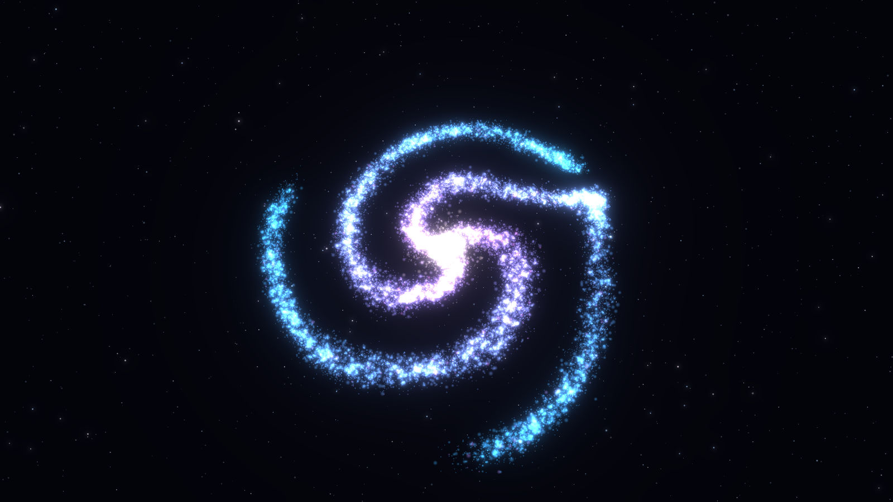
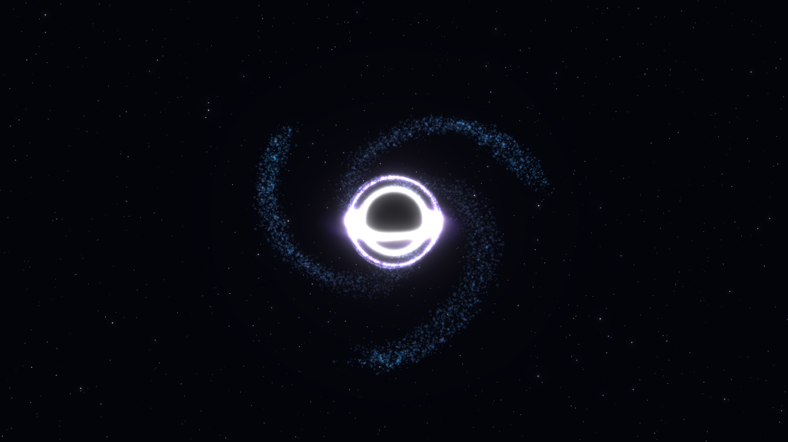
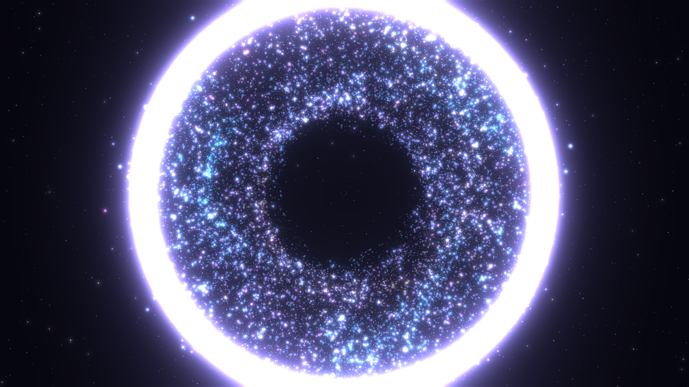
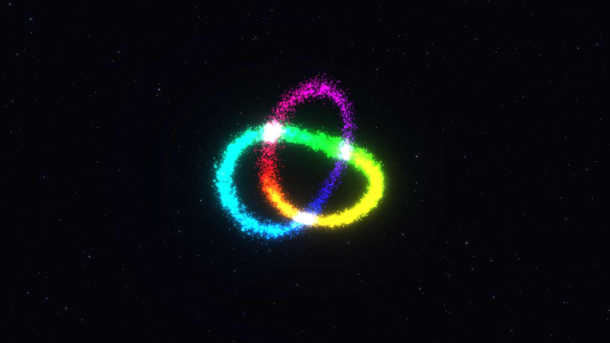
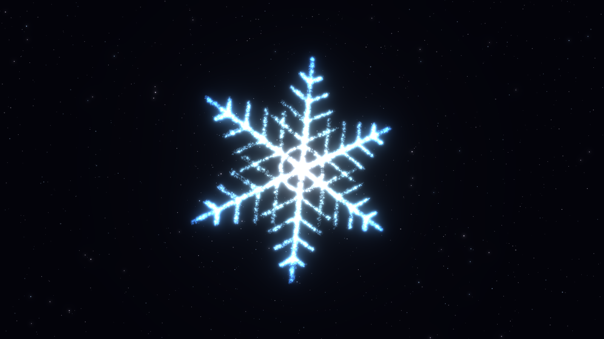
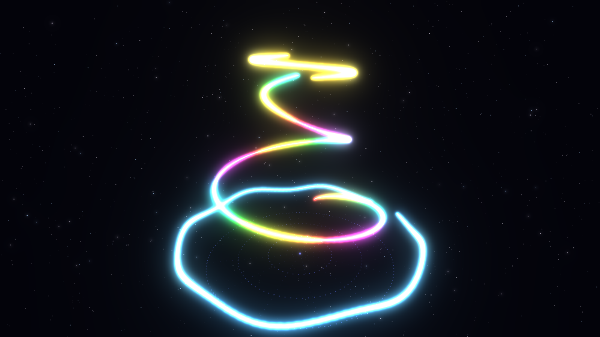

# Aether

**Shape light with your hands and your voice.**
Aether is a browser experience: your webcam finds your hands, 20,000 glowing particles react to your gestures, and you change the world by speaking.
There is nothing to install and no account. The camera picture never leaves your computer.



| Make a fist: black hole | Open the hand: explosion |
| --- | --- |
|  |  |

| Say "rainbow" | Say "ice" |
| --- | --- |
|  |  |


*Air Drawing: the sculpture turns while you draw, so a hand that only moves up and down draws a 3D spiral.*

## Worlds

| # | World | Idea | Status |
| --- | --- | --- | --- |
| 01 | **Hand Magic** (`/hand`) | Particles follow your hand. Fist, open hand, pinch, two hands. | ✅ Ready |
| 02 | **Air Drawing** (`/draw`) | Paint neon light into the air. It turns into a 3D sculpture you can save and turn. | ✅ Ready |
| 03 | **Hologram Mirror** (`/mirror`) | You become light: particles, falling letters or a blue hologram. Fall apart into dust. | ✅ Ready |
| 04 | Voice World (`/voice`) | Your voice grows a living landscape. | Planned |

### Hand Magic: what you can do

| Gesture | What happens |
| --- | --- |
| ☝️ Move your index finger | Particles swirl around your finger and follow it |
| ✊ Make a fist and hold it | A black hole opens and grows, the galaxy is pulled into its ring |
| 🖐️ Open the fist | The black hole explodes. The bigger it was, the bigger the bang |
| 🤏 Pinch, move, let go | You grab a star and throw it. It flies like a comet and bounces off the edges |
| 🙌 Two hands apart or together | Zoom the whole world |

**Voice commands** (English): `fire`, `ice`, `galaxy`, `rainbow`, `save`, `next world`.
**Keyboard:** `1`–`4` elements, `S` save a picture, `C` camera picture, `N` next world.
**No camera?** Play with the mouse: hold the left button for a black hole, let go to explode, right button to throw a star, wheel to zoom.

### Air Drawing: what you can do

| Gesture | What happens |
| --- | --- |
| 🤏 Pinch thumb and index finger, move | You draw a glowing line. Sparks fly from the pen, a theremin tone follows your hand height |
| ✊ Fist and move | You grab the sculpture and turn it. Let go and it keeps spinning |
| 🙌 Two open hands | Zoom |

The sculpture stands on a slowly turning platform, like clay on a potter's wheel. You draw on a flat plane, but the
sculpture turns under the pen, so every line becomes a real 3D curve.

**Voice commands:** `red`, `blue`, `green`, `gold`, `rainbow`, `undo`, `clear`, `save`, `next world`.
**Keyboard:** `1`–`5` colors, `Z` undo, `X` clear, `S` save, `C` camera picture.
**Mouse:** left button draws, right button turns, wheel zooms.
**Save** stores the picture *and* the 3D data. In the gallery, drawings marked **3D** open as a sculpture you can turn with the mouse.

### Hologram Mirror: what you can do

The camera separates you from the room (person segmentation) and every part of you becomes a point of light.

| Style | Look |
| --- | --- |
| Particles | Glowing dots in your real colors, with depth from light and shadow |
| Matrix | Falling green letters, only inside your body |
| Hologram | Blue sci-fi hologram with scan lines, a glowing outline and glitches |

| Gesture | What happens |
| --- | --- |
| 👋 Wave quickly left or right | Previous or next style |
| ✊ Fist | You fall apart into dust that blows away |
| 🖐️ Open hand | The dust flies back and builds you again |

**Voice commands:** `particles`, `matrix`, `hologram`, `save`, `record`. **Keyboard:** `1`–`3`, arrow keys, `S`, `R`.
This world needs a camera.

### Video clips (all worlds)

Say `record`, press `R` or use the record button: Aether records **5 seconds** of the world with its sounds (never the microphone)
and saves the clip in the gallery. The browser records MP4 when it can, otherwise WebM.

## How it works

```
webcam ──► MediaPipe Hand Landmarker (WebAssembly + GPU, in the browser)
              │  21 points per hand, up to 2 hands
              ▼
          gestures.ts   simple geometry: finger stretch ratios, thumb–index distance,
              │         a 3-frame stabilizer and a One Euro filter against jitter
              ▼
          controller.ts the rules: fist → black hole, fist → open → explosion, pinch → star
              ▼
          world.ts      20,000 particles: spring to the element's shape, swirl, gravity,
              │         explosion impulses. Three.js points + bloom post-processing
              ▼
          screen        ◄── voice.ts (Web Speech API) switches the element
                        ◄── sound.ts (Web Audio) makes every sound live, no audio files

saved picture ──► FastAPI /api/gallery ──► file on disk + row in SQLite
3D drawing ─────► validated by Pydantic (colors, number of points) ──► JSON in SQLite
                  ──► GET /api/gallery/{id}/sculpture ──► 3D viewer with orbit controls
video clip ─────► canvas.captureStream + Web Audio stream ──► MediaRecorder (MP4/WebM)
                  ──► checked by its file header ──► file on disk, played in the gallery

Hologram Mirror:
webcam ──► MediaPipe Image Segmenter (selfie, landscape) ──► person mask 256 × 144
       ──► camera picture read as a 168 × 95 grid ──► 16,000 points, shaded per style
           (letters come from one texture with 64 glyphs, picked in the fragment shader)
```

Both worlds share one engine: `stage.ts` (renderer, star sky, bloom), `handInput.ts` (camera hands and a mouse
"hand" with the same interface), voice control with a word list per world, and the sound engine.

- **Frontend:** React 19, TypeScript, Vite, Three.js, MediaPipe Tasks Vision, Web Speech API, Web Audio API
- **Backend:** FastAPI, Pydantic, SQLite, served by Uvicorn. After a build it also serves the website, so everything runs on one port.
- **Tests:** Vitest for gesture rules, swipe detection, voice matching and the sculpture model; pytest for the gallery API (pictures, sculptures, videos, database upgrade).

### Privacy

- Hand detection and person segmentation run fully in the browser. No camera frame is sent anywhere.
- The model files are loaded from Google's MediaPipe model storage when you start the camera.
- Video clips record only the 3D picture and the world's own sounds, never the camera or the microphone.
- Voice commands use the browser's speech recognition. Edge and Chrome send the audio to their speech service to turn it into text.
- Saved pictures stay on your computer (`backend/data`).

## Run it

You need Python 3.11+ and Node.js 20+.

**Windows, one click:** double-click `start.cmd`. The first start installs everything, then the site opens at http://127.0.0.1:8020.

**Development (two terminals):**

```bash
cd backend
python -m venv .venv
.venv/Scripts/python -m pip install -r requirements.txt   # macOS/Linux: .venv/bin/python
.venv/Scripts/python -m uvicorn app.main:app --port 8020 --reload
```

```bash
cd frontend
npm install
npm run dev        # http://localhost:5173, /api is forwarded to port 8020
```

Use Edge or Chrome. The camera only works on `localhost`, `127.0.0.1` or HTTPS.

**Tests:**

```bash
cd frontend && npm test && npm run typecheck
cd backend && .venv/Scripts/python -m pytest
```

## Project layout

```
backend/
  app/main.py        FastAPI app: gallery API, sculpture validation, saved images, built website
  app/gallery.py     image validation, files on disk, SQLite (with automatic upgrade of old databases)
  tests/             pytest
frontend/
  src/engine/        shared 3D stage, particle world, element shapes, light sculptures, sparks
  src/vision/        camera + MediaPipe, gesture rules (unit tested), camera and mouse input
  src/voice/         speech recognition and command matching (unit tested)
  src/audio/         sounds made with Web Audio, including the theremin
  src/worlds/hand/   Hand Magic: rules and the frame loop
  src/worlds/draw/   Air Drawing: turning scene, rules and the frame loop
  src/worlds/mirror/ Hologram Mirror: the three styles, dust effect and the frame loop
  src/media/         video clip recording
  src/components/    shared interface parts, 3D sculpture viewer, recorder
  src/pages/         start page, worlds, gallery
start.cmd            install, build and run on Windows
```
